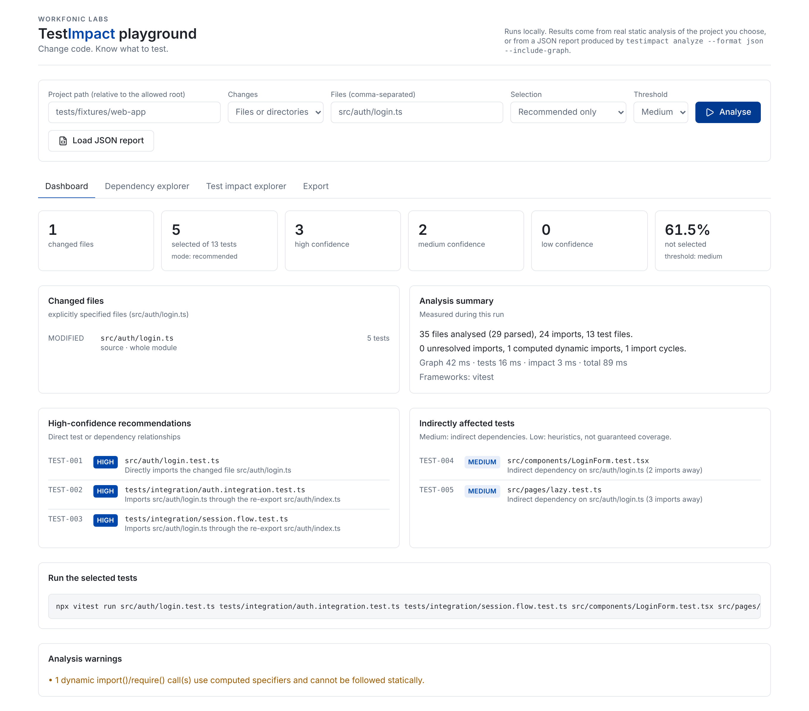
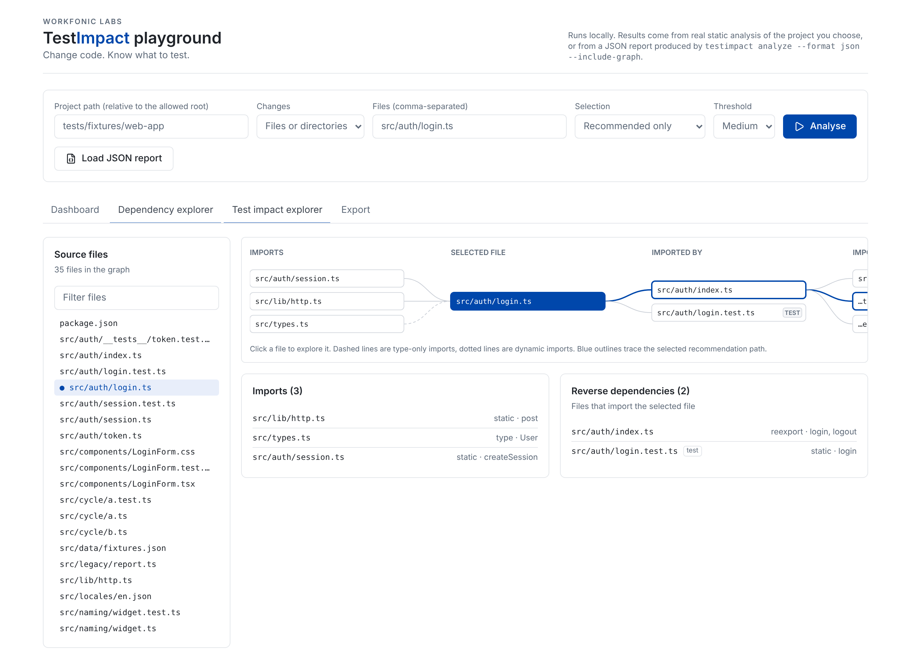
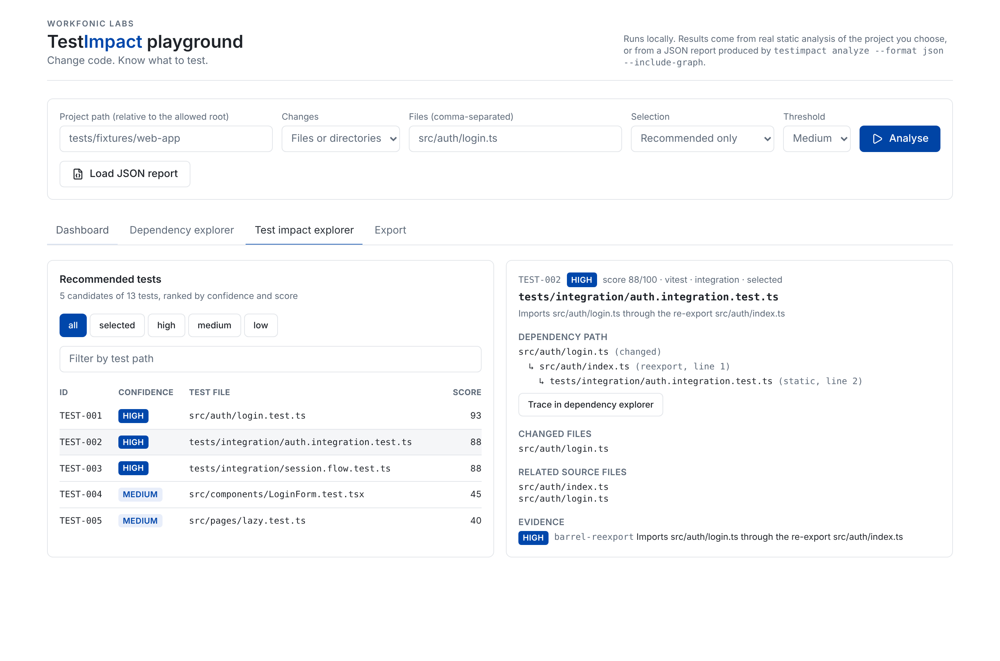

# Playground

The playground is an optional local web interface for exploring analysis results. It uses real analysis results only: either a fresh analysis of a local project run by its API route, or a JSON report you load.

```sh
npm ci
npm run playground        # builds the packages, then starts Next.js on http://127.0.0.1:3210
```

## Views

- **Dashboard**: changed files (with changed exports), selected vs total tests, counts per confidence level, high-confidence recommendations, indirectly affected tests, run commands, warnings and measured timings.
- **Dependency explorer**: searchable file list and an interactive graph of the selected file's imports, reverse dependencies and second-level dependents. Click any node to move to it. Type-only and dynamic imports are drawn differently. Tracing a recommendation highlights its dependency path.
- **Test impact explorer**: ranked recommendations with filters; details show the reason, dependency path, changed exports, related source files and all evidence.
- **Export**: download the JSON report or the same self-contained HTML report the CLI produces.





## Loading reports from the CLI

```sh
npx testimpact analyze --base main --format json --include-graph -o report.json
```

Then use **Load JSON report**. Without `--include-graph` the dependency explorer is unavailable.

## Security model

- The server binds to `127.0.0.1`. API routes reject requests whose host is not `localhost`/`127.0.0.1`.
- Analysis requests can only target directories inside `TESTIMPACT_ALLOWED_ROOT` (default: the repository containing the playground). Set it to analyse other projects: `TESTIMPACT_ALLOWED_ROOT=$HOME/code npm run playground`.
- Analysis is read-only and runs with caching disabled.
